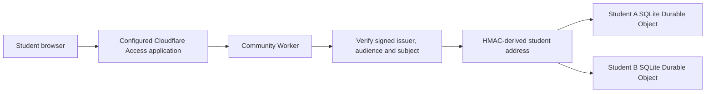

# Community foundation architecture

The first milestone is an independent, private workspace for a second student. The existing personal Bridge remains a separate system. This project starts with empty storage and a small allowlist of reusable pure code; it does not import the personal deployment's data or connected accounts.

## Request and ownership boundary

The Worker verifies the `Cf-Access-Jwt-Assertion` signature, expected issuer, application audience, token lifetime and end-user claims. Only the configured Access issuer's bounded public-key endpoint is used. Service identities and caller-selected signing keys are rejected. Missing or incomplete configuration fails closed.

`TENANT_ID_KEY` authenticates a domain-separated HMAC of the verified issuer and subject. This derives a stable pseudonymous student ID without making email the ownership key. The Worker selects `STUDENTS.getByName('student-v1:' + tenantId)`. Each Durable Object permanently binds its owner on first successful use and rejects a different owner. No operation searches a global student table.

Caller-provided tenant selectors are rejected. Forwarded email, arbitrary identity headers and resource IDs cannot select another student's storage. The browser's optional `X-Workspace-Id` header is an equality guard against a stale account screen; it does not select or authenticate an account. Unknown fields and filters fail validation. Cross-origin browser mutations are rejected.

Static application assets are separate from protected `/api/*` data. The health route reports only that HTTP handling is available. A future Access deployment must configure admission and revocation deliberately; the repository does not establish university membership or grant access by itself.

## Components

| Component | Current responsibility |
|---|---|
| `src/auth.js` | Verify Access identities and derive student addresses. Only public signing keys may be cached across requests. |
| `src/index.js`, `src/http.js` | Route authenticated requests, enforce request bounds, reject unexpected fields and cross-origin writes. |
| `src/student-object.js` | SQLite Durable Object and authenticated-service RPC boundary. |
| `src/store.js`, `src/validation.js` | Scoped records, ownership, immutable identities, revisions, quotas, atomic receipts, export and deletion. |
| `src/calendar-import.js`, `src/core/ics.js` | Parse a supplied calendar file into a bounded window with explicit warnings. No remote feed fetch. |
| `src/ui.js`, `src/write-intent.js` | Onboarding and manual-data interface; save intents and receipt readback. |

There are no provider-token tables, collection queues, remote source adapters or AI-provider clients in this milestone.

## Resource and save contract

Courses are entered per student, with independent code, section and term identifiers. Referenced courses must exist in that student's store. Course identity cannot be silently reassigned to another section or term. Material, progress and calendar identities likewise cannot be moved to another course or source through an update.

Every write supplies an `operation_id` and `expected_revision`. Creation uses revision `0`. Within one synchronous SQLite transaction, the store checks the current revision, writes the record, saves its receipt and increments the account revision. A conflicting revision or reused operation ID with different content fails. An exact retry returns the original saved record and receipt without applying a second write. Lost acknowledgements are resolved with the original operation and receipt readback.

The browser's pending-write queue lives in memory on the current page. It preserves uncertain packets for a retry in that page, but is not a persistent outbox. Reloading or crashing the browser requires reconciliation against saved records and receipts before recreating an uncertain operation. A persistent, account-scoped recovery interface is future product work.

Calendar requests fingerprint the original ICS input, rather than the changing server clock or parsing window, so a delayed exact retry is stable. Imports require a registered source in the same workspace. A course/source pair has one calendar record; reimport replaces its event set through a revision-checked update. Recurring occurrences may share a UID when their start times differ.

Progress accepts `reported` or `unknown` verification. A `done` record requires an explicit reported submission; this API cannot claim source verification. Learning stores explicit saved handoffs, not entire conversations. Assessed outcomes require an observed response and independent work or hints. Explanations remain unassessed discussion. Partial, incorrect and self-reported work never increment independent observed-correct counts. Updating one session replaces that session's observations, avoiding duplicate accumulation.

## Connection and freshness truth

Registering a URL creates `needs_authorization` or `manual_import` metadata. It never creates a live connection, a successful sync timestamp or permission to read a school account. URLs with embedded credentials, query parameters or fragments are rejected; callers must use public site addresses.

ICS import considers a window from 30 days before import to 180 days afterward. Unsupported recurrence and parser gaps remain visible warnings. `coverage.complete` describes parsing of the supplied file within that window; it does not mean the school portal or Google Calendar is complete or current. Records explicitly carry `live_sync: false`, an import timestamp and unknown source freshness. An empty imported calendar is not evidence that a student has nothing due.

## Current resource limits

All limits apply independently to each student. These are safety bounds for the foundation, not a measured production capacity promise.

| Limit | Bound |
|---|---:|
| JSON request body | 350,000 bytes |
| ICS source text | 250,000 bytes |
| Parsed events per import | 500 |
| Stored JSON record | 128,000 bytes |
| Material text | 100,000 UTF-16 code units, also subject to the byte bound |
| Records per resource kind | 100; calendars have a separate limit of 20 |
| Current records per student | 10,000,000 bytes |
| Retained save receipts | 5,000 or 20,000,000 bytes, whichever is reached first |
| Learning observations per session | 50 distinct topics |
| Learning resume text | 8,000 UTF-16 code units |

Limits reject an oversized save rather than silently discarding content. The UI may impose smaller text limits. Material listings return metadata; individual reads return the saved text. Collection limits keep current HTTP listings complete. More extensive semester storage, retention policies and archives require a later design.

## Storage lifecycle and deletion

Current-workspace export returns only the authenticated student's latest profile and resource records. It excludes identity-provider tokens, HMAC secrets and internal owner bindings. It is a user export, not an implemented disaster-restoration format. Historical record copies inside save receipts remain available to exact retries but are not included in the current-workspace export.

Deletion requires `confirm: 'DELETE_MY_WORKSPACE'` and the fresh `account_revision` returned by export. The transaction removes every active resource and previous receipt, then stores a minimal deletion receipt and a tombstone containing the pseudonymous owner binding, revision and deletion time. Exact repetition of that deletion returns its original receipt. Old reads, writes and receipt lookups fail with `account_deleted`; export returns an empty deleted workspace. That identity cannot start again in this milestone.

This describes active application storage. It does not promise immediate physical erasure from provider recovery systems. Cloudflare's SQLite Durable Objects documentation describes point-in-time recovery covering the preceding 30 days; a deployment needs an explicit recovery-copy and deletion policy. [Cloudflare storage reference](https://developers.cloudflare.com/durable-objects/api/sqlite-storage-api/#pitr-point-in-time-recovery-api).

The server can read content. Neither access controls nor pseudonymous IDs make this user-held end-to-end encryption. Before real accounts are admitted, set a documented retention schedule for current records, historical receipts, operational logs and backups. Decide how verified deletion requests propagate into any future token vault, storage bucket, search index and AI provider.

Back up and protect `TENANT_ID_KEY` together with the account-addressing configuration. Rotation changes addresses; changing the identity issuer or subject mapping also changes ownership addresses. Either event requires a tested migration. An old signing key from the identity provider is a separate concern and is handled through that provider's public-key verification lifecycle.

## Pilot release gates

| Gate | Evidence required before real student use |
|---|---|
| Deployed identity and isolation | Configure a new Access application and secrets; verify real end-user sign-in, account changes and revocation. Repeat adversarial two-student tests against the deployed endpoints. |
| Supported source onboarding | Choose and build the first real connector. Obtain applicable provider/institution approval, request least-privilege consent, isolate tokens, and demonstrate refresh, reconnect and revoke behavior. A pasted website address is insufficient. |
| Privacy and lifecycle | Publish understandable consent, retention and deletion terms. Review logging and support access, student materials permissions, backup retention and incident ownership. |
| Recovery | Restore synthetic account state into a clean environment with receipts and ownership intact. Test key migration, failed writes, unavailable providers and interrupted jobs. A normal restart is not a disaster-recovery drill. |
| Capacity and cost | Measure concurrent exam-week use, large imports, per-student quotas and provider throttling. Add rate/spend controls and identify who funds free student access. Storage caps alone are not a budget governor. |
| Connector reliability | Add durable background jobs with source-specific health, freshness targets, bounded retries and visible failures. Exercise revoked sessions, interrupted imports and duplicate delivery. |
| Teaching and product validation | Integrate an actual model and permitted source retrieval, then test evidence grounding, understanding checks, saves and fresh-client resume. Run a small observed student pilot before widening access. |

The order is deliberate: finish independent sign-in and one supported source path, validate two real consenting accounts, then build out automation and teaching. There is no cloud deployment, live Google/eLC authorization, AI teaching or unattended collection in the current foundation.
